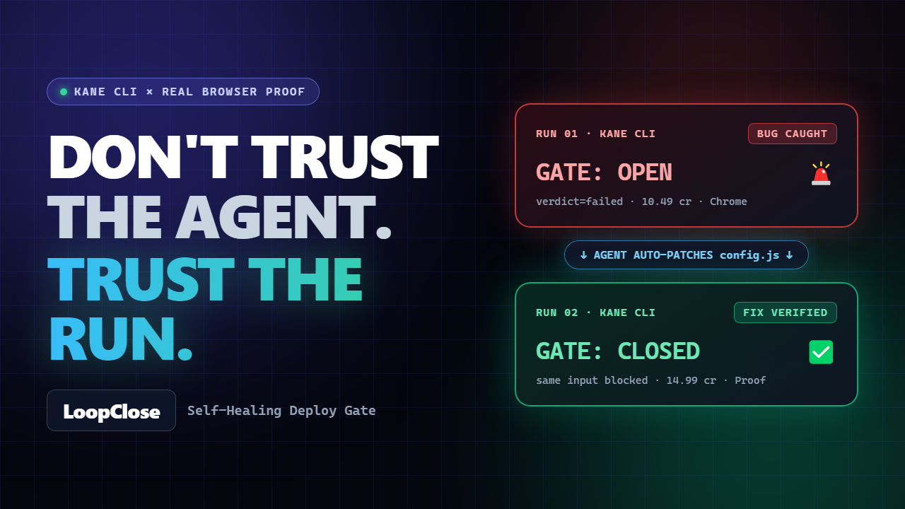

# LoopClose



A deploy gate that refuses to ship until a real browser proves the flow. The coding agent fixes what Kane catches, Kane checks again, and the verdict travels back to the agent as machine-readable NDJSON. The loop is the product.

- **Live Demo:** https://akuraposo.github.io/loopclose/app/
- **Repository:** https://github.com/akuraposo/loopclose

## The loop

```
agent builds buggy variant
        ↓
Kane CLI opens the real app in Chrome, asserts the gate
        ↓  --agent NDJSON + evidence link
agent reads verdict → flips the broken flag → rebuilds
        ↓
Kane CLI runs again → passing verdict + evidence link
        ↓
deploy allowed
```

## Run it

```bash
# terminal 1: serve the app
python -m http.server 8137 --directory app

# terminal 2: run the closed loop
python loop.py
```

`loop.py` works cross-platform (Windows, macOS, Linux) and writes two real Kane runs into `proof/`:

1. `01-bug-confirmed.ndjson` — the buggy build lets a failed verdict open the gate. Kane's assertion that the gate reads `GATE: OPEN — deploy allowed` passes, which confirms the bug (`10.49` credits).
2. `02-fix-verified.ndjson` — the agent flips `app/config.js` to the fixed build; Kane's assertion that the gate reads `GATE: CLOSED` passes, which confirms the fix (`14.99` credits).

Both runs upload evidence to Test Manager and print their `test_url` links.

One-off Kane run:

```bash
kane-cli run \
  "Go to http://127.0.0.1:8137/?verdict=failed&evidence=https://example.com/proof and verify the gate text shows GATE: CLOSED" \
  --agent --headless --timeout 240
```

## Why this fits the challenge

- **Ships:** the gate is a real, usable flow live on GitHub Pages and locally, not a slide.
- **Verified:** Kane catches a real security regression (failed verdict opening the gate) and then proves the fix.
- **Closed loop:** the agent parses Kane's `run_end` verdict and changes the build in response; Kane re-verifies. `loop.py` is the loop.
- **Craft:** no backend, no secrets, no framework. `index.html` + `config.js` + one cross-platform Python driver.

## Files

| Path | Role |
|---|---|
| `app/index.html` | the release gate UI and its verdict logic |
| `app/config.js` | agent-controlled build flag (`LOOPCLOSE_BUG`) |
| `loop.py` | cross-platform agent driver: build → Kane → read verdict → fix → Kane |
| `proof/01-bug-confirmed.ndjson` | real Kane run confirming the seeded regression (`10.49` cr) |
| `proof/02-fix-verified.ndjson` | real Kane run verifying the fix (`14.99` cr) |
| `proof/loop-run.log` | driver run log with Test Manager evidence URLs |
| `demo/loopclose-thumbnail.png` | demo video thumbnail |
| `LAUNCH.md` | launch posts and submission notes |
