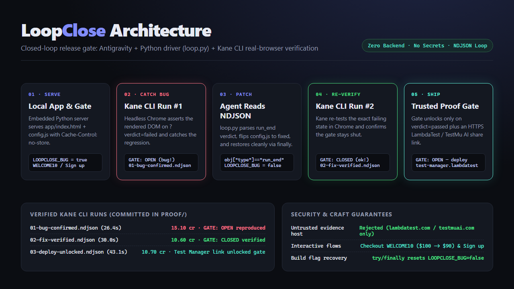

# LoopClose

[](https://youtu.be/3wC081DVVkk)

A deploy gate that refuses to ship until a real browser proves the flow. Built with **Antigravity** and **Kane CLI**: the agent catches what fails in Chrome, fixes the build, re-verifies with Kane CLI, and tracks the verdict as machine-readable NDJSON. The loop is the product.

- **Demo Video (3:34):** https://youtu.be/3wC081DVVkk
- **Live Demo:** https://akuraposo.github.io/loopclose/app/
- **Repository:** https://github.com/akuraposo/loopclose



## The loop

```
agent builds buggy variant (LOOPCLOSE_BUG = true)
        ↓
Kane CLI opens the real app in Chrome, asserts the gate
        ↓  --agent NDJSON + evidence link
agent reads run_end verdict → flips config.js → serves uncached build
        ↓
Kane CLI runs again → passing verdict + Test Manager evidence link
        ↓
trusted proof unlocks deploy (try/finally guarantees clean repo state)
```

## Run it

One-command closed loop (auto-starts an embedded `app/` server on `127.0.0.1:8137` with `Cache-Control: no-store` if none is running, and always restores `config.js` on exit):

```bash
python loop.py
```

Optional 3rd verification step feeding the real Test Manager URL back into `?verdict=passed`:

```bash
python loop.py --verify-open
```

Or run the unit & Chromium browser test suite (no Kane credits spent):

```bash
python -m unittest test_loop.py -v
```

`loop.py` works cross-platform (Windows, macOS, Linux) and stores three real Kane CLI runs in `proof/`:

1. `01-bug-confirmed.ndjson` — the buggy build lets a failed verdict open the gate. Kane's assertion that the gate reads `GATE: OPEN — deploy allowed` passes, confirming the regression (`15.10` credits).
2. `02-fix-verified.ndjson` — the agent flips `app/config.js` to the fixed build; Kane's assertion that the gate reads `GATE: CLOSED` passes, confirming the fix (`10.60` credits).
3. `03-deploy-unlocked.ndjson` — `--verify-open` feeds Run 2's real Test Manager share link into `?verdict=passed`; Kane confirms the gate unlocks to `GATE: OPEN — deploy allowed` (`10.70` credits).

All three runs upload evidence to Test Manager and print their `test_url` links.

### Interactive Gate & Verification Flows (`app/index.html`)

- **Guest checkout (`WELCOME10`)** and **Sign up** candidate sandbox flows toggle between `good` and `broken` build variants so judges can test real UI regressions directly on [GitHub Pages](https://akuraposo.github.io/loopclose/app/).
- **Trusted evidence host check:** on the fixed build, only `https://` share links on `lambdatest.com` / `testmuai.com` (such as Test Manager reports) can unlock `GATE: OPEN — deploy allowed` — arbitrary or unverified URLs are rejected.

## Why this fits the challenge

- **Ships:** real interactive checkout/signup gate live on GitHub Pages and locally via `python loop.py`.
- **Verified:** Kane CLI catches a real security regression (failed verdict opening the gate) and verifies the fix in Chrome (`proof/`).
- **Closed loop:** `loop.py` parses Kane's `run_end` NDJSON verdict, patches `app/config.js`, serves uncached assets, and triggers Kane re-verification.
- **Craft:** zero external runtime dependencies, no secrets, `try/finally` build restoration, and automated Chromium E2E tests in `test_loop.py`.

## Files

| Path | Role |
|---|---|
| `app/index.html` | interactive release gate UI, checkout/signup sandbox, and trusted evidence validation |
| `app/config.js` | agent-controlled build flag (`LOOPCLOSE_BUG`) |
| `loop.py` | cross-platform agent driver with embedded no-cache static server and `try/finally` guard |
| `test_loop.py` | unit & Playwright Chromium E2E test suite verifying NDJSON parsing, gate logic, and XSS safety |
| `proof/01-bug-confirmed.ndjson` | real Kane run confirming the seeded regression (`15.10` cr) |
| `proof/02-fix-verified.ndjson` | real Kane run verifying the fix (`10.60` cr) |
| `proof/03-deploy-unlocked.ndjson` | real Kane run unlocking deploy with Run 2's Test Manager URL (`10.70` cr) |
| `proof/loop-run.log` | driver run log with Test Manager evidence URLs |
| `demo/loopclose-architecture.png` | closed-loop architecture diagram |
| `demo/loopclose-thumbnail.png` | demo video thumbnail |
| `LAUNCH.md` | launch posts and submission notes |
